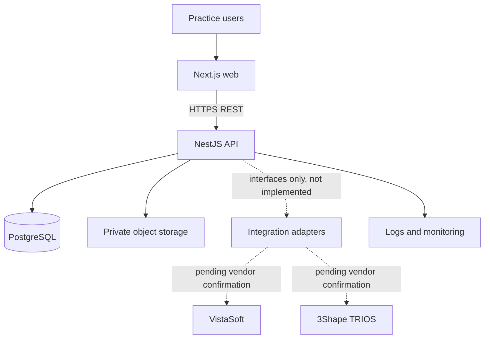

# 04 — System Architecture and Data Model

## Technology direction
- Frontend: Next.js + TypeScript.
- Backend: Node.js + NestJS + TypeScript.
- Database: PostgreSQL.
- ORM/migrations: Prisma.
- API: REST + OpenAPI.
- UI: Tailwind CSS + shadcn/ui.
- Package manager: pnpm.
- File storage: private S3-compatible object storage.
- Tests: Jest for NestJS; Vitest where appropriate for web/shared packages.

## Repository structure (as built)
```text
apps/api            NestJS API (modular monolith). Prisma schema + migrations live in apps/api/prisma
apps/web            Next.js application (includes the same-origin /api proxy route handler)
packages/contracts  shared zod schemas and types (API <-> web); replaces the originally proposed packages/shared
e2e                 Playwright browser + accessibility tests (own workspace package)
ops                 backup / restore / restore-drill scripts
docs                project documentation
```
The originally proposed `packages/database` was **not** created: only the API accesses the database, so Prisma lives in `apps/api` (ADR-0002 decisions 1 and 2). `packages/ui` and `packages/config` were not created either; shared UI components live in `apps/web/src/components`.

## Architecture


*Status note:* there is no background-job runner (the only scheduled work is an in-process hourly session purge) and the integration adapters are TypeScript interfaces only (`apps/api/src/integrations`). Observability is structured JSON logs plus health/readiness endpoints; no metrics/alerting stack is deployed.

Start with a modular monolith, not microservices. Keep clear modules: Auth, Organisation, Practices, Users, AccessControl, Patients, MedicalHistory, Appointments, ClinicalRecords, DentalChart, TreatmentPlans, Imaging, Billing, Reports, Audit, Storage and Integrations.

## Data isolation
One organisation contains four practices. Organisation-owned records have organisation relationship; practice-scoped records carry practice scope. Derive access from authenticated server-side identity and assignments. Never trust a browser-supplied practice ID as proof of access. Test cross-practice access denial. PostgreSQL row-level security may be considered as defence in depth after connection/session design is tested.

## Core entities
*As built:* `Role` and `Permission` are code (enum + `apps/api/src/access/permissions.ts`), not tables; `UserPracticeRole` is `user_role_assignments`; `PatientDocument` is covered by `imaging_assets`; MFA adds `user_mfa`, `mfa_recovery_codes`, `mfa_challenges`; billing adds `invoice_sequences` and `payment_allocations`; appointments add `appointment_events`. Authoritative list: `apps/api/prisma/schema.prisma` and docs/12.

Original list:
Organisation; Practice; User; Role; Permission; UserPracticeRole; Patient; PatientPractice; PatientContact; MedicalHistoryEntry; Allergy; PatientDocument; Appointment; ClinicalEncounter; ClinicalNoteVersion; DentalChartEntry; TreatmentPlan; TreatmentPlanItem; ImagingAsset; Invoice; InvoiceLine; Payment; AuditEvent.

## Data rules
Use UUID identifiers, foreign keys, unique constraints and indexes. Persist timestamps in UTC and display in Africa/Johannesburg. Patient identity must support duplicate review and explicit cross-practice policy. Clinical notes need draft/finalised states, author, timestamps and version/amendment history. Posted financial records must not be silently rewritten; use credits/reversals. Currency values use decimal/numeric, not floating point.

## Imaging storage
PostgreSQL stores metadata, ownership, object key, MIME type, size, checksum, modality, source and lifecycle state. Private object storage contains the binary. File access must be authorised on every request; signed URLs, if used, must be short-lived and issued after checks. Never place sensitive patient information in object keys.

## API conventions
Prefix /api/v1; HTTPS; JSON; UUID; ISO 8601; validated DTOs; consistent safe errors; bounded pagination; allow-listed filters; generated OpenAPI. Proposed resources: /auth, /practices, /users, /patients, /appointments, /encounters, /treatment-plans, /imaging, /invoices, /payments, /reports and /audit. This is a design map, not a claim endpoints exist.

## Architecture risks
Vendor access, archive size, practice connectivity, cross-practice privacy policy, migration quality and support model. Revisit decisions when evidence arrives.
